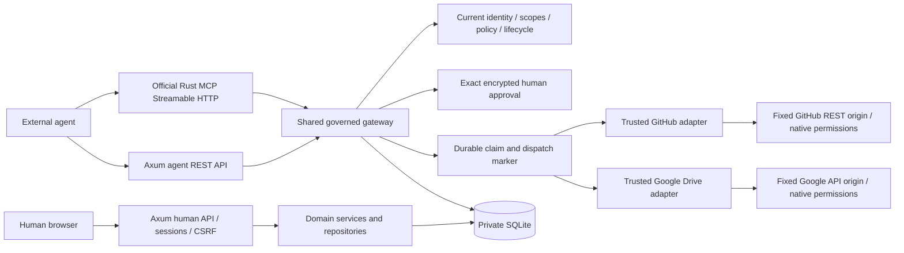

# Agent Control Rust architecture

A modular monolith in four crates, one process and SQLite. GitHub and Google Drive remain independent provider adapters. The JavaScript frontend is embedded in the executable. Python is confined to historical reference and optional validation tools.

Admission holds a short BEGIN IMMEDIATE transaction: resolve current identity, check scope/policy/control, validate parameters/allowlist, bind the request and consume approval or return ASK, then durably claim the unique agent/idempotency key. Final dispatch separately rechecks current authority, expiry and fingerprint and commits the dispatch marker before calling a provider. External I/O holds no database transaction. The receipt/outcome and audit commit afterward.

Transitions are `prepared → dispatched → executed`, with failed or uncertain outcomes retained durably. Prepared/dispatched records surviving process termination become uncertain at startup. A failed/unfinished claim is not automatically dispatched again. A successful repeat returns only its receipt. GitHub issue creation has no exactly-once guarantee; the ledger prevents blind repeats rather than pretending to remove provider uncertainty.

A revocation that precedes final admission blocks dispatch. One following that committed admission cannot cancel an already admitted call. A process-level runtime lock prevents a second server from performing startup recovery on a live server's database.

See [RUST_MODULE_MAP.md](RUST_MODULE_MAP.md), [SECURITY_PARITY.md](SECURITY_PARITY.md), [MIGRATION_VALIDATION.md](MIGRATION_VALIDATION.md) and the historical [Phase 2 architecture](docs/reviews/phase2/ARCHITECTURE.md).
