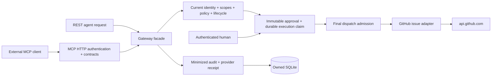

# Architecture — first governed GitHub action

Agent Control is a standalone modular backend and administration shell. External agents use either REST or the official MCP SDK Streamable HTTP endpoint `/mcp/`. Both transports delegate to the same GatewayService; neither calls adapters directly. There is no model intelligence layer.

## Boundaries

Composition stays in bootstrap.py. Policy decisions, approval storage, admission, dispatch, journal, MCP protocol and GitHub I/O have independent modules. Configuration/authentication of the connector remain in the backend; the external integration implementation is in top-level connectors/github.

Agents have no human roles. Scopes intersect between the agent and its credential. Every tool requires explicit permission, enabled connector and execution flag, active identity and no emergency stop. The default remains deny, and configured connectors initialize disabled. GitHub issue creation additionally requires human approval regardless of an ALLOW policy.

Only two GitHub tools are registered: issues.list and issues.create. The fixed public API host and finite repository allowlist are operator-controlled. ZNode's repository is rejected as connector configuration. There is no repository deletion tool, raw HTTP proxy, arbitrary URL, subprocess tool or credential-in-arguments path.

## Request and approval lifecycle

MCP arguments use the envelope `parameters`, `idempotency_key`, optional `approval_id`. The connector/tool are derived exclusively from the MCP tool name; additional authority fields are rejected. Discovery is recomputed using current authorization for every request. SDK stateless transport carries no privileged session capable of surviving token revocation.

Admission validates parameters and repository constraints. ASK produces an immutable grant bound to agent, credential, connector, tool, exact canonical parameters and idempotency key. The GitHub target/title/body preview is encrypted with a separate-purpose cipher derived from the local runtime key. Human management endpoints decrypt it; agent transports never return it. The original body is not stored in audit.

After approval, the client resends the identical proposal. A conditional transaction consumes the grant and commits a prepared idempotency record. Dispatch then rechecks current authority, scopes, policy, lifecycle, approval expiry and the approving human, and commits the dispatch marker. Only then does bounded external I/O start, with no SQLite transaction held over the network. Revocations can take effect for all later admissions while an admitted request finishes.

Native GitHub permissions still apply. The adapter accepts only native success statuses, refuses redirects, validates provider results and does not retry uncertain writes. GitHub does not provide a guaranteed idempotent issue-create endpoint; the durable platform claim blocks blind replay. A crash after dispatch produces an uncertain execution requiring reconciliation, not a second issue.

Success/failure is saved in a separate transaction. A minimized receipt stores GitHub issue number/URL or read count, not titles, bodies or provider credentials. Replay rechecks authority and returns a receipt. Exactly-once provider side effects are not claimed.

## Persistence and runtime

The original schema remains the baseline, with an additive migration adding encrypted previews, dispatch markers, receipts and audit result summaries. Existing owned Agent Control databases are preserved and migration is idempotent. No ZNode database or migration is accessed.

The default runtime can start without GitHub configuration and performs no external I/O. Operator flags enable the GitHub catalog; connector state and tool policies must then be configured separately. Private mode-0600 token files are supported. The explicitly restricted gh-demo source reads one credential into memory from the existing local gh keychain; it never copies that credential to SQLite or a file.

MCP OAuth authorization, SSO/MFA, managed secret vault, worker leases/cancellation, multi-tenant isolation and externally tamper-evident audit remain future work. The pilot is not an enterprise production security certificate.
