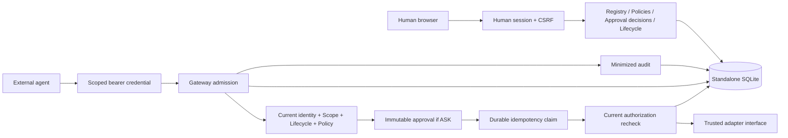

# Architecture

Agent Control is a modular FastAPI application, a SQLite persistence layer and an independent browser UI. It accepts proposals from external agents and places deterministic controls before the trusted adapter boundary. There is no intelligence layer, chatbot or agent provider SDK.

The default registry is empty and execution is disabled. The adapter interface is implemented only by isolated tests. There is no simulated production execution or external application traffic.

## Module ownership and dependencies

API routes validate transports and use centralized human/agent dependencies. `bootstrap.py` composes services; no module imports a route or application singleton. Services own transitions. Repositories accept explicit database connections, which lets approval consumption, execution claims and audit events share one transaction.

The gateway uses `GatewayAuthorization.check` at admission and immediately before dispatch. That same function controls discovery. Credential status and agent state are read from the database every time. Scopes are the intersection of the agent's assigned scopes and the credential's scopes. A policy cannot grant missing scopes. Unconfigured tool policies deny. Tools declaring mandatory confirmation remain ASK even if a policy requests ALLOW.

Policies may be saved for future tool identifiers, but this does not register or enable any adapter. Connector execution state is independent of policy. Newly registered connectors initialize disabled. Administrators explicitly enable a trusted connector.

## Persistence

One owned data directory contains the hashing key and `agent-control.sqlite3`. The schema lives in `backend/app/core/database/schema.sql`, version 1. WAL, foreign keys and a finite busy timeout are enabled. Connections close deterministically. Write transitions use `BEGIN IMMEDIATE`.

| Table | Purpose |
|---|---|
| humans / sessions / login_attempts | Human roles, hashed session credentials, CSRF, expiry and local login throttling |
| agents / credentials | Separate agent registry, metadata, scopes and revocable credential hashes |
| policies | Explicit agent + connector + tool decision |
| connector_state / emergency_state | Server-side execution controls |
| approvals | Credential-bound request fingerprint, safe summary, decision, expiry and consumption |
| executions | Durable agent-scoped idempotency key, fingerprint and result state |
| audit_events | Actor, operation, decision, identifiers, timestamps and parameter shape |

Approval binding columns are immutable through database triggers. Audit update/delete triggers make the application ledger append-only. A database owner can still alter triggers or the file; tamper-proof audit is not claimed.

## Execution contract

Admission validates identity, connector state, policy and strict JSON schema, then checks idempotency. ASK creates an immutable approval binding agent, credential, connector, tool, canonical parameters and idempotency key. The original parameters are not persisted; after approval the client resubmits the same proposal with `approval_id`.

Approval consumption and the prepared execution claim commit before adapter dispatch. A second transaction revalidates current authorization, detects ALLOW → ASK tightening, verifies approving-human availability and expiry, then dispatches. ASK → ALLOW does not bypass an offered approval's validity. A crash or exception after a durable claim blocks blind retry. Completed replay returns an execution receipt without caching sensitive result values.

The synchronous foundation holds a write transaction across bounded adapter dispatch, serializing control changes with that dispatch. This is suitable for the foundation tests, not long-running enterprise I/O. A worker lease/fencing protocol, deadlines and cancellation are required before production external adapters. Emergency stop cannot cancel an already dispatched action or undo external side effects.

## UI and extension boundary

The frontend is plain ES modules and CSS served at the same origin. Human session credentials are HttpOnly cookies; CSRF remains in memory. There are live pages for login, overview, agents and details, policies, approvals, audit, security and settings. Integrations accurately shows an empty catalog and planned features. No collaboration or messaging UI is retained.

Adapter implementations will live under top-level `connectors/`. Configuration, credentials and registration stay in backend connector modules. MCP transport must call the same gateway service, not adapters directly. Transport authorization and interoperability remain unimplemented. See the [MCP authorization specification](https://modelcontextprotocol.io/specification/2025-11-25/basic/authorization) for the future transport design. Application startup uses the [FastAPI lifespan interface](https://fastapi.tiangolo.com/advanced/events/).
